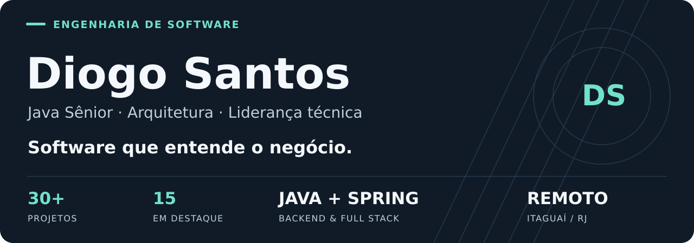
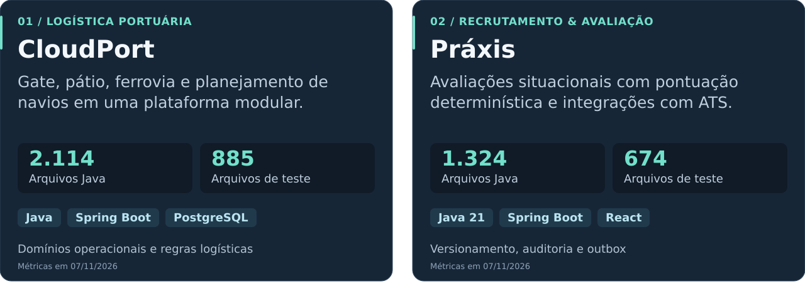
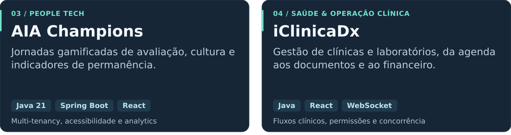
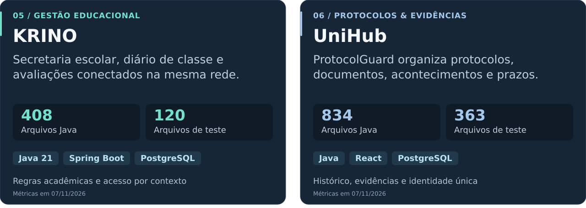
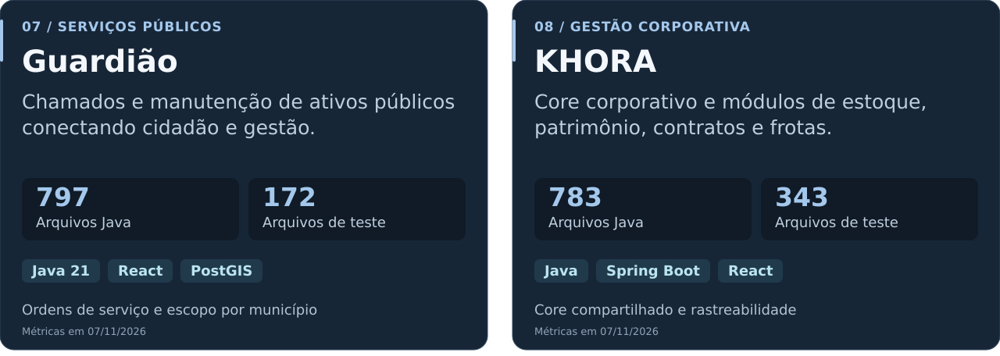
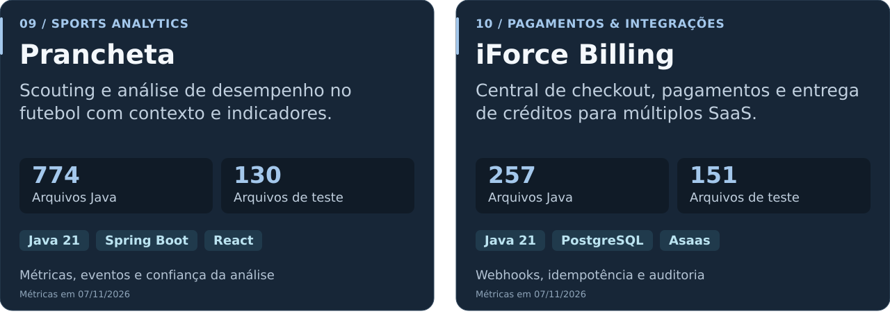
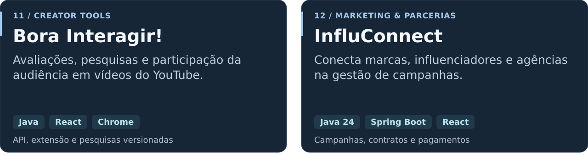
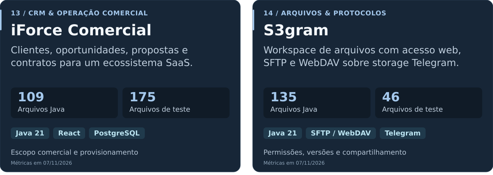
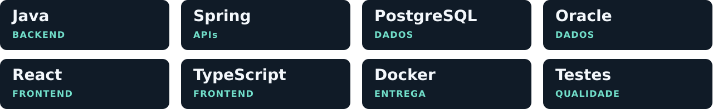

<picture>
  <source media="(max-width: 600px)" srcset="./assets/hero-mobile.svg">
  
</picture>

  
  
  

  <a href="#sobre-mim">Sobre mim</a> &nbsp;·&nbsp;
  <a href="#portfólio">Portfólio</a> &nbsp;·&nbsp;
  <a href="#stack">Stack</a> &nbsp;·&nbsp;
  <a href="#experiência">Experiência</a> &nbsp;·&nbsp;
  <a href="#contato">Contato</a>

## Sobre mim

Sou desenvolvedor Java Sênior com experiência em sistemas governamentais, logística portuária e plataformas SaaS. Trabalho da regra de negócio à API, das integrações à interface, com atenção a segurança, qualidade e manutenção.

Minha trajetória reúne desenvolvimento, liderança de QA e atuação entre operação e TI. Participei da implantação do Navis N4 e desenvolvo produtos para saúde, educação, recrutamento e gestão. Busco desafios como Java Sênior e Tech Lead com participação no código, em modelo 100% remoto.

### Atividade e tecnologias no GitHub

  
  

#### Calendário de contribuições

Os gráficos se atualizam automaticamente. As linguagens refletem o código público; os principais produtos privados estão apresentados no portfólio abaixo.

## Portfólio

### 15 projetos em destaque

A ordem considera profundidade funcional, arquitetura, integrações e evidências de testes versionados. Os produtos estão em diferentes estágios de evolução.

<picture>
  <source media="(max-width: 600px)" srcset="./assets/projects-01-mobile.svg">
  
</picture>

<picture>
  <source media="(max-width: 600px)" srcset="./assets/projects-02-mobile.svg">
  
</picture>

<picture>
  <source media="(max-width: 600px)" srcset="./assets/projects-03-mobile.svg">
  
</picture>

<picture>
  <source media="(max-width: 600px)" srcset="./assets/projects-04-mobile.svg">
  
</picture>

<picture>
  <source media="(max-width: 600px)" srcset="./assets/projects-05-mobile.svg">
  
</picture>

<picture>
  <source media="(max-width: 600px)" srcset="./assets/projects-06-mobile.svg">
  
</picture>

<picture>
  <source media="(max-width: 600px)" srcset="./assets/projects-07-mobile.svg">
  
</picture>

<picture>
  <source media="(max-width: 600px)" srcset="./assets/projects-08-mobile.svg">
  
</picture>

Os códigos desses 15 produtos são privados. Posso conversar sobre minha participação, os desafios e as decisões técnicas pelo [LinkedIn](https://www.linkedin.com/in/diogo-santos-044b40b4/).

Ver os 15 projetos em texto e entender a seleção

A curadoria prioriza sistemas com regras de negócio, arquitetura organizada, integrações e testes identificáveis no repositório. A ordem representa uma avaliação editorial por amostragem; não é uma auditoria integral de qualidade ou uma certificação de produção.

| Ordem | Projeto | Aplicação | Engenharia em destaque |
| --- | --- | --- | --- |
| 01 | CloudPort | Gate, inventário, pátio, ferrovia, navios e faturamento. | Domínios operacionais e regras logísticas. |
| 02 | Práxis | Jornadas por competência, relatórios e integração com Gupy e Recrutei. | Versionamento, auditoria e outbox. |
| 03 | AIA Champions | Avaliação, vieses inconscientes e permanência no ecossistema DiverSCInnova. | Multi-tenancy, acessibilidade e analytics. |
| 04 | iClinicaDx | Agenda, atendimento, documentos, laboratórios e rotinas financeiras. | Fluxos clínicos, permissões e concorrência. |
| 05 | KRINO | Matrículas, diários, avaliações em rede e acompanhamento pedagógico. | Regras acadêmicas e acesso por contexto. |
| 06 | UniHub | Protocolos pessoais, evidências, prazos e dossiês sob uma identidade única. | Histórico, evidências e identidade única. |
| 07 | Guardião | Chamados, triagem, ordens de serviço, equipes e ativos públicos. | Ordens de serviço e escopo por município. |
| 08 | KHORA | Organização, almoxarifado, patrimônio, licitações, contratos, frotas e serviços. | Core compartilhado e rastreabilidade. |
| 09 | Prancheta | Scouting, partidas, jogadores e indicadores de desempenho no futebol. | Métricas, eventos e confiança da análise. |
| 10 | iForce Billing | Catálogo, pedidos, checkout hospedado, eventos e entrega de créditos. | Webhooks, idempotência e auditoria. |
| 11 | Bora Interagir! | Studio, extensão Chrome, participação web, pesquisas e comunidade. | API, extensão e pesquisas versionadas. |
| 12 | InfluConnect | Campanhas, propostas, contratos, pagamentos, mensagens e marketplace. | Campanhas, contratos e pagamentos. |
| 13 | iForce Comercial | Clientes, pipeline, propostas, pedidos, contratos e comissões. | Escopo comercial e provisionamento. |
| 14 | S3gram | Arquivos, versões, lixeira e compartilhamento. Não é uma API AWS S3 compatível. | Permissões, versões e compartilhamento. |
| 15 | iForce Mail | Domínios, caixas, mensagens e anexos com integração ao iForce Comercial. | Identidade, anexos e webhooks assinados. |

## Stack

<picture>
  <source media="(max-width: 600px)" srcset="./assets/stack-mobile.svg">
  
</picture>

| Foco | Tecnologias e práticas |
| --- | --- |
| Backend e arquitetura | Java, Spring Boot, Spring Security, JPA/Hibernate, APIs REST, microsserviços, monólitos modulares, DDD e Clean Architecture |
| Dados e integrações | PostgreSQL, Oracle, Redis, Flyway, Kafka, RabbitMQ, OAuth2, JWT e webhooks |
| Frontend | React, TypeScript, Angular, Next.js, JSF e PrimeFaces |
| Qualidade e entrega | JUnit, Mockito, MockMvc, Testcontainers, Selenium, Cypress, Git, Docker e CI/CD |

## Experiência

- Setor público: projetos para TJGO, CGE-RR, ATI-TO e Prefeitura de Fortaleza, com sistemas administrativos, transparência, APIs e auditoria.
- Logística portuária: trajetória na Sepetiba Tecon, implantação do Navis N4, desenvolvimento em Java/Groovy e conexão entre tecnologia e operação.
- Produtos SaaS: plataformas com múltiplos perfis, integrações, pagamentos, permissões e jornadas de usuários.
- Qualidade e liderança: automação de testes, investigação de falhas, alinhamento de requisitos e apoio às decisões técnicas.

Formação e acessibilidade

Graduação em Logística e pós-graduações em Desenvolvimento Web, Big Data e Ciência de Dados, Gestão de Pessoas e RH e Cloud Computing.

Sou profissional PCD e valorizo acessibilidade no produto e no ambiente de trabalho.

## Contato

<a href="https://www.linkedin.com/in/diogo-santos-044b40b4/">
<picture>
  <source media="(max-width: 600px)" srcset="./assets/contact-mobile.svg">
  
</picture>
</a>

  <a href="https://www.linkedin.com/in/diogo-santos-044b40b4/">LinkedIn</a> &nbsp;·&nbsp;
  <a href="mailto:diogo.01501@gmail.com">diogo.01501@gmail.com</a> &nbsp;·&nbsp;
  <a href="https://wa.me/5521967081952">WhatsApp</a>

